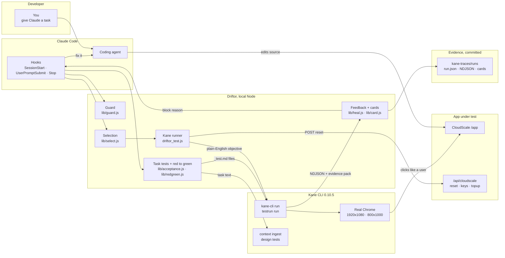
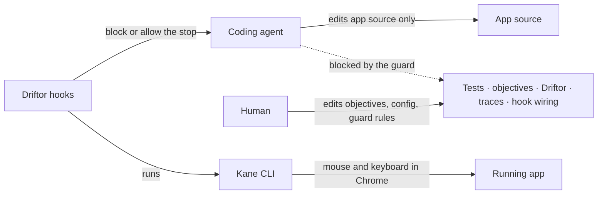
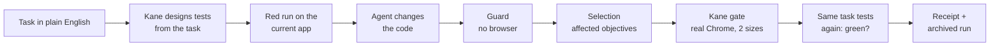
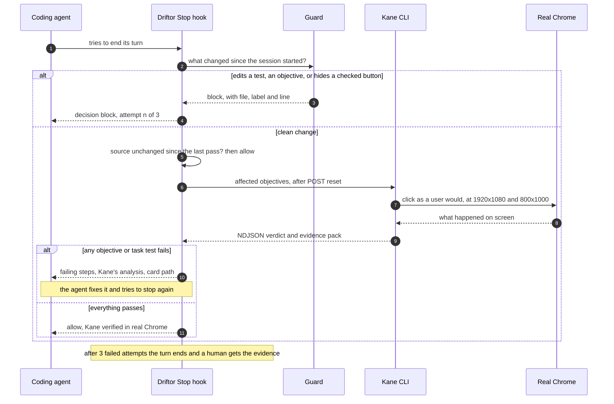
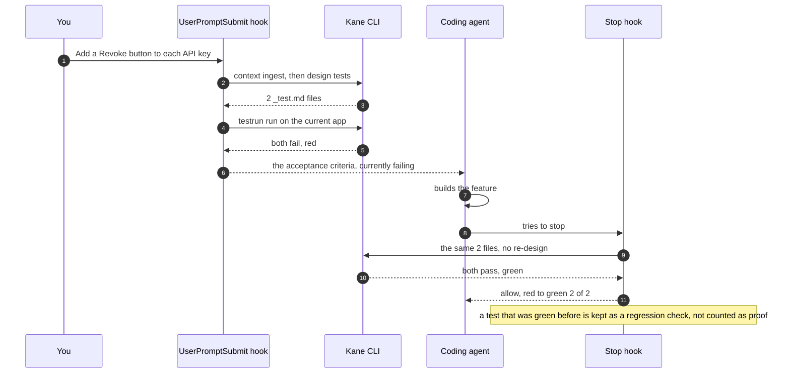

# Driftor

**A Claude Code hook that won't let an AI coding agent say "done" until Kane CLI has used the app in real Chrome.**

Coding agents check their own UI work with unit tests that run in JSDOM, a simulated browser that builds the page but never draws it. A button covered by an invisible layer, or a label that disappears on a narrow screen, passes every one of those tests. Driftor blocks the agent's turn, has Kane CLI check the app in real Chrome at desktop and narrow sizes, and sends any failure back to the agent to fix. Everything is measured by one comparison: **on the five bugs in this repo, the unit tests caught 0 of 5 and Kane in real Chrome caught 5 of 5.**

Built for the Kane CLI Online Hackathon (TestMu AI, November 2026) · App: `<LIVE_URL>` · Demo video: `<VIDEO_URL>` · Code: [github.com/mrnetwork0001/Driftor](https://github.com/mrnetwork0001/Driftor)

**Judges, start here:** run `npx -y github:mrnetwork0001/Driftor demo`. It needs no Kane account, no credits and no browser. In about 20 seconds it replays real archived runs from this repo: Kane catching a bug the unit tests missed, Claude fixing it, the tests Kane designed for a new feature, and the bug zoo table. Every line it prints is read from a file in [`kane-traces/`](kane-traces/).

[](https://kaneclihack.sh)
[](https://nextjs.org)
[](LICENSE)

---

## Five things Driftor does, no Kane account needed to see them

| Feature | What it is | Try it without a Kane account |
| --- | --- | --- |
| **The gate** | A Claude Code Stop hook ([`driftor.js --hook`](driftor.js)). When the agent tries to end its turn, Kane runs the plain-English objectives in [`driftor.config.json`](driftor.config.json) in real Chrome at 1920×1080 and 800×1000. A failure blocks the stop and hands Kane's failing steps back to the agent, up to 3 attempts. In the first recorded session Claude was asked for an unrelated change with a bug already on the branch: Kane blocked it, Claude found the invisible layer and fixed it, Kane passed. 12 turns, 291 s, no human. | `npx -y github:mrnetwork0001/Driftor demo session`, or the runs [`08-00-54-950Z`](kane-traces/runs/2026-11-18T08-00-54-950Z/run.json) (blocked) and [`08-03-06-216Z`](kane-traces/runs/2026-11-18T08-03-06-216Z/run.json) (passed). |
| **Red to green** | Before the agent writes any code, Kane designs acceptance tests from the task itself and runs them on the current app. They should **fail** (red), which proves they test something new. When the agent stops, the same test files run again and must **pass** (green). *Old tests can only tell you nothing broke. Red to green proves the new feature works.* | The receipt [`redgreen.json`](kane-traces/runs/2026-11-24T12-26-27-142Z/redgreen.json): "Add a Revoke button to each API key", 2 tests, both failed before the change and passed after. |
| **The guard** | The agent can't mark its own homework. Before any Kane credit is spent, the hook refuses a change that edits the tests, the objectives or Driftor itself, or that deletes, hides or disables the button a check clicks ([`lib/guard.js`](lib/guard.js)). | `npm run driftor:guard-demo` after cloning: 4 cheats blocked, the real fix allowed. Recorded in [`kane-traces/guard/demo/`](kane-traces/guard/demo/). |
| **What the user saw** | For every failing check, a card built from Kane's own evidence pack: the screenshot of the failing step, the element Kane clicked, the click point, and "unit tests: passed" next to "Kane in real Chrome: failed". The hook tells the agent to open it, so Claude looks at the page instead of guessing ([`lib/card.js`](lib/card.js)). | 15 cards, for example [pointer-events on desktop](kane-traces/runs/2026-11-23T23-24-43-619Z/card-desktop-occlusion-gate.png). On the site, every failing verdict in the bug zoo links to its card. |
| **The bug zoo** | Five one-line regressions an agent could plausibly make ([`lib/regressions.js`](lib/regressions.js)). All five keep the unit suite green and break the app for a real user. | `npx -y github:mrnetwork0001/Driftor demo zoo`, or the table below. |

### The bug zoo, verified on 2026-11-23

Each verdict comes from a real archived Kane run. Unit tests: `Tests 27 passed (27)` in every row.

| Bug | The one-line change | Kane · desktop 1920×1080 | Kane · narrow 800×1000 | Run |
| --- | --- | --- | --- | --- |
| *healthy* | none | ✓ pass | ✓ pass | [`23-05-42-767Z`](kane-traces/runs/2026-11-23T23-05-42-767Z/run.json) |
| `overlay`: a transparent full-screen layer takes the clicks | `app/app/MaintenanceNotice.tsx`: `pointer-events-none fixed inset-0 z-50` → `fixed inset-0 z-50` | **✗ fail** | **✗ fail** | [`23-22-51-442Z`](kane-traces/runs/2026-11-23T23-22-51-442Z/run.json) |
| `pointer-events`: a loading-state class left on the button | `app/app/CloudScaleDashboard.tsx`: adds `pointer-events-none` to the "Generate Production API Key" button | **✗ fail** | ✓ pass | [`23-24-43-619Z`](kane-traces/runs/2026-11-23T23-24-43-619Z/run.json) |
| `opacity`: the closed mobile menu is faded out, not removed | `app/app/CloudScaleDashboard.tsx`: `"invisible opacity-0"` → `"opacity-0"` | ✓ pass | **✗ fail** | [`23-27-05-414Z`](kane-traces/runs/2026-11-23T23-27-05-414Z/run.json) |
| `breakpoint`: the top-up link only shows on wide screens | `app/app/CloudScaleDashboard.tsx`: adds `hidden lg:inline-block` to "+ Top Up Quota ($250)" | ✓ pass | **✗ fail** | [`23-10-35-876Z`](kane-traces/runs/2026-11-23T23-10-35-876Z/run.json) |
| `stale-cache`: the dashboard re-reads a cached balance | `app/app/CloudScaleDashboard.tsx`: `cache: "no-store"` → `cache: "force-cache"` | **✗ fail** | **✗ fail** | [`23-13-02-408Z`](kane-traces/runs/2026-11-23T23-13-02-408Z/run.json) |

In the `stale-cache` run the server recorded the top-up (475,000 cents) while the page kept showing `$4,500.00`. No click was blocked; the page just showed the wrong number. JSDOM never sees any of these, because it doesn't lay out the page, doesn't know what is on top of what, and its `fetch` is mocked.

### More to explore

| Feature | What it is | Where |
| --- | --- | --- |
| **Only the checks a change affects** | Each objective lists the files it `covers`. The hook diffs the source against the files Kane last passed on and runs only the affected objectives. Changing the top-up route ran 1 of 2 objectives in 81.5 s. | [`lib/select.js`](lib/select.js), run [`23-29-09-253Z`](kane-traces/runs/2026-11-23T23-29-09-253Z/run.json) |
| **Checks designed from the task** | Without the red run, the Stop hook still reads the agent's task from the session transcript and has Kane design up to 2 tests for it. In the Revoke session Kane designed "Revoke KEY-001 and retain KEY-002 after reload" and "Revoke the last remaining KEY-002", and both passed. | [`lib/acceptance.js`](lib/acceptance.js), run [`2026-11-24T00-05-41-127Z`](kane-traces/runs/2026-11-24T00-05-41-127Z/run.json) |
| **CI gate** | A GitHub Actions workflow builds the app, runs the gate headless, judges the evidence pack against a policy and keeps one sticky pull request (PR) comment up to date with the verdict and the cards. | [`.github/workflows/driftor.yml`](.github/workflows/driftor.yml), [`docs/ci.md`](docs/ci.md), [`policies/driftor-gate.yaml`](policies/driftor-gate.yaml) |
| **`driftor init`** | Sets Driftor up in another Next.js or Vite repo: copies the runtime to `.driftor/`, writes placeholder objectives, merges the hooks into `.claude/settings.json` and adds npm scripts. | [`scripts/init.js`](scripts/init.js) |
| **Per-run app state** | `/app?run=<id>` gives each run its own saved state file, so two runs never share a balance. | [`lib/cloudscale-store.ts`](lib/cloudscale-store.ts) |
| **Parallel mode** | `--parallel` runs objectives in separate Chrome instances. It works, but gives no speedup today (see [Known limits](#known-limits-of-kane-cli-we-found)). | [`driftor_test.js`](driftor_test.js), run [`23-08-06-506Z`](kane-traces/runs/2026-11-23T23-08-06-506Z/run.json) |
| **Traces viewer** | Every objective's raw Kane events, plus the exact feedback the agent would get right now. | `/hud` |

The site at `/` reads the archived runs live: the bug zoo with links to each card, a run log with a "from task" column for the checks Kane designed, and replays of the recorded Claude sessions. `/app` is **CloudScale**, the demo app Driftor guards: an API-gateway dashboard with a real backend ([`app/api/cloudscale/`](app/api/cloudscale/)) whose state persists to `.data/`.

## Why Kane CLI is essential

Driftor is a policy around one capability: a browser agent that reads plain English and uses a real Chrome the way a person does.

- **No real browser, no verdict.** Every zoo bug is about layout, stacking, breakpoints or caching. Only a browser that draws the page can see them. [`driftor_test.js`](driftor_test.js) runs `kane-cli run "<objective>" --agent` per objective and reads Kane's NDJSON (one JSON event per line) stream for the verdict.
- **No plain English, no tests from the task.** Red to green works because Kane's assurance commands (`kane-cli context ingest` and `kane-cli design tests`) turn the agent's task, in the user's words, into runnable `_test.md` files ([`lib/acceptance.js`](lib/acceptance.js)). There is no recording to replay for a feature that doesn't exist yet.
- **No selectors, nothing to rot.** The objectives say what a user does and sees ("Click "+ Top Up Quota ($250)" with a mouse click, as a user would"). When an agent restyles the page there are no selectors to update, and no selectors for it to quietly change.
- **No evidence pack, no card.** Each Kane run seals screenshots, step results and click coordinates in an evidence pack. The cards ([`lib/card.js`](lib/card.js)) and the CI policy verdict (`kane-cli evidence verdict --policy`) are built from it.

## Architecture

Driftor has four layers:
- **Claude Code** runs the agent and calls Driftor's hooks at session start, on each prompt and on each stop.
- **Driftor** ([`driftor.js`](driftor.js) and [`lib/`](lib/)) decides what to check, runs the guard, drives Kane and writes the feedback.
- **Kane CLI** designs tests and runs them in real Chrome, and writes NDJSON traces and evidence packs.
- **The app under test** is any local web app; here it is CloudScale at `/app`, with a reset endpoint so every check starts from the same state.

Diagrams render on GitHub.

### System overview



**One process per hook call.** Each hook is a short `node driftor.js` run with the hook's JSON on stdin; it exits with a JSON decision on stdout. State between calls lives in `.data/` (attempt counts, the last verified fingerprint, the guard's starting point) and `.driftor/` (designed tests and red baselines), both gitignored. Runs, cards and guard decisions are archived under `kane-traces/` and committed.

**Opt-in.** The hooks do nothing unless the session was started with `DRIFTOR_HOOK=1` (`npm run agent`), so an ordinary Claude session in this repo never spends Kane credits.

### Who can do what



| Actor | Can | Can never |
| --- | --- | --- |
| **Coding agent** | Edit the app's source, read the feedback and the card, end its turn | Edit a protected file, or delete, hide or disable a control a check uses, without the guard blocking the stop. Get the fix handed to it: the feedback names failing steps, never the file or the fix. |
| **Driftor hooks** | Block the stop (up to 3 attempts), run Kane, reset the app's state, archive evidence | Edit the app's source. Act in a session without `DRIFTOR_HOOK=1`. |
| **Kane CLI** | Drive Chrome, design tests from the task (plus a diff summary of at most 4,000 characters, `acceptance.includeDiff`), write traces and evidence | Edit anything. It checks the running app, not the code. |
| **Human** | Change objectives, `guard.protect`, `maxHealAttempts`, or turn the guard off (`DRIFTOR_GUARD=0`) | Nothing is hidden from the human: every block and every run is archived. |

### One task, start to finish



The design step and the red run happen once, when you send the prompt. Everything from the guard on happens each time the agent tries to stop. A guard block or a Kane failure sends the agent back to "Agent changes the code" with the evidence.

### The Stop hook



### Red to green



The prompt hook runs synchronously, so the app can't change during the red run. In the live run it took about 200 s before the agent could start. A follow-up prompt in the same session keeps the first baseline instead of designing new tests.

### A real example, end to end

Task: *"Add a Revoke button to each API key that removes it from the list and keeps it removed after reload"*, recorded on 2026-11-24 ([receipt](kane-traces/runs/2026-11-24T12-26-27-142Z/redgreen.json)):

1. Kane designed 2 tests from the task (13.94 credits).
2. Red run on the unchanged app: both failed at step 1, "each listed key having its own Revoke control" (61.04 credits). Traces: [`redgreen-before/`](kane-traces/runs/2026-11-24T12-22-19-718Z/redgreen-before/).
3. The feature was added. The first green run gave 1 red→green and 1 red→red ([run](kane-traces/runs/2026-11-24T12-22-19-718Z/redgreen.json)): Kane checked "KEY-001 is absent from the list" against the whole page and matched the activity log line "KEY-001 … revoked". Kane's own end-of-run analysis said the check was wrong, not the app.
4. The same files run again on the same app: 2 of 2 red→green (17.56 credits, lower because Kane replayed cached steps).

The receipt shows where a red→red test failed before and after (step 1 before, step 2 after), so a human can tell "got further" from "stuck". The feature code was then reverted so the zoo keeps measuring the same app.

## Safety model

- **The agent never sees the answer.** The feedback holds Kane's failing steps, its analysis, the raw NDJSON and a card path, never the file or the fix. In feedback on the tests designed from the task, source file names are scrubbed from Kane's text ([`lib/acceptance.js`](lib/acceptance.js) `scrubSource`).
- **The agent can't change the checks.** The guard compares the working tree with the commit and uncommitted files recorded at session start ([`lib/guard.js`](lib/guard.js)). A bug that was already there when the session began is never blamed on the agent, and fixing any of the five zoo bugs is never flagged.
- **Hard limits.** At most `maxHealAttempts` (3) blocked stops per session, then the turn ends and a human is told. At most 5 designed tests per task (`acceptance.max`, 2 here). A design budget of `acceptance.budgetSeconds` (480 s).
- **Same state every time.** Before every objective and every designed test, the runner calls the app's reset endpoint. Kane's window size is read back after every change, because `set-window` exits 0 even when it rejects a size.
- **Off switches.** `DRIFTOR_HOOK` unset turns every hook into a no-op. `DRIFTOR_GUARD=0`, `DRIFTOR_ACCEPT=0`, `DRIFTOR_REDGREEN=0` and `DRIFTOR_CARDS=0` turn off one feature each.
- **Secrets stay out.** Kane's evidence packs contain the account email, so they are gitignored; only the screenshot is copied into a card. CI credentials come from repository secrets.
- **Tests.** 27 unit tests (Vitest, JSDOM) for the demo app and 71 tooling tests (`node --test`) for Driftor itself, including the guard's cheats, red→green with a stub Kane, the cards and the demo.

## What's real and what's simulated

| Real | Simulated or staged |
| --- | --- |
| Every Kane verdict, trace, card and credit figure in this README, from runs archived in `kane-traces/runs/` | The five zoo bugs are injected on purpose (`npm run driftor:inject -- <bug>`) so the demo is repeatable |
| Three recorded Claude Code sessions with the hooks armed, sanitized transcripts in [`kane-traces/agent-sessions/`](kane-traces/agent-sessions/) | CloudScale is a demo app made for this project; its keys come from a cryptographic random generator but grant nothing |
| The red→green receipts, from live Kane runs | In the red→green run the feature was added by the developer applying the Revoke diff from the earlier Claude session, not by a new live session |
| The guard's five decisions in [`kane-traces/guard/demo/`](kane-traces/guard/demo/) | They come from a scripted replay of cheats, not from a Claude session that tried to cheat |
| `driftor init` on the open-source mdn/todo-react app: passed healthy in 119 s, caught an injected `pointerEvents: "none"` Add button in 61 s | Those runs were made in a scratch folder and are not archived in this repo |
| The CI workflow, policy and comment renderer, covered by tooling tests | The workflow has not yet run on GitHub; it needs the `KANE_USERNAME` and `KANE_ACCESS_KEY` secrets |

## Tech stack

Node 18+ (developed on Node 26, CI on Node 20) · Kane CLI 0.10.5 (`@testmuai/kane-cli`) with Google Chrome · Claude Code hooks (SessionStart, UserPromptSubmit, Stop) · Next.js 14.2.5, React 18.3, Tailwind CSS 3.4 for the site and the demo app · Vitest 2.1.9 with JSDOM for the unit suite · `node --test` for the tooling suite · GitHub Actions for CI · fallback heal agent: Gemini CLI.

## Run it locally

**Prerequisites:** Node 18+, Google Chrome, a TestMu AI account for Kane CLI, and [Claude Code](https://claude.com/claude-code) for the agent loop.

```bash
git clone https://github.com/mrnetwork0001/Driftor.git
cd Driftor
npm install
npm run kane:login          # one time, opens the browser

npm run dev                 # terminal 1: the site and the demo app (first free port from 3000)
npm run driftor:preflight   # terminal 2: checks Node, Kane login, the app and an agent
npm run driftor:check       # dry run: shows the plan, starts no browser
```

**The agent loop:**

```bash
npm run driftor:inject -- overlay   # put a zoo bug on the branch (unit tests still pass)
git commit -am "wip"                # commit it, or the agent may simply spot it in git diff
npm run agent                       # Claude Code with the hooks armed; ask it for any change
```

**Each feature on its own:**

```bash
npm run driftor:gate                          # every objective in real Chrome; exits 1 on failure
npm run driftor:red -- "Add a Revoke button to each API key"   # design + red run
npm run driftor:green                         # the same tests after your change, plus the receipt
npm run driftor:guard                         # check the working tree for cheats (exit 1 on a violation)
npm run driftor:card                          # cards for the latest failing run
npm run driftor:accept -- "<task>"            # design and run checks for a task, no red run
npm run demo                                  # the archived replay, as judges see it
npm run driftor:reset                         # revert any injected bug
```

A full gate (two objectives) takes about two minutes; each objective takes about a minute.

### All commands

| Command | What it does |
| --- | --- |
| `npm run agent` | `DRIFTOR_HOOK=1 claude`: Claude Code with Driftor's hooks armed |
| `npm run driftor:gate` | Runs the objectives in real Chrome. Add `-- --headless` for CI |
| `npm run driftor:test -- --changed` | Runs only the objectives the uncommitted change affects (`--files a,b` to name files, `--only <id>` for one objective, `--parallel` for separate Chrome instances) |
| `npm run driftor:check` | Dry run: target, plan, placeholders, reset and unit command |
| `npm run driftor:red -- "<task>"` / `driftor:green` | Red→green by hand: design and red run, then the same tests after the change |
| `npm run driftor:accept -- "<task>"` | Kane designs tests for the task and runs them, with the gate (add `--no-gate` to skip it) |
| `npm run driftor:guard` | The guard on the working tree. `-- --archive` records the decision like the hook does |
| `npm run driftor:guard-demo` | Plays four cheats and the real fix through the guard |
| `npm run driftor:card -- <runDir>` | Makes "what the user saw" cards for a run folder |
| `npm run driftor:zoo` / `driftor:inject -- <bug>` / `driftor:reset` | List, inject or revert the zoo bugs |
| `npm run driftor:heal` | One-shot heal for agents without hooks: evidence to `claude -p` (or `gemini`), then re-verify |
| `npm run driftor:watch` | Re-runs the gate when watched source changes |
| `npm run driftor:init -- --dir <repo>` | Sets Driftor up in another repo |
| `npm run demo` | The no-account replay (`-- --fast`, `-- zoo`, `-- --list`) |
| `npm run test:unit` / `npm run test:tooling` | The JSDOM unit suite / Driftor's own tests |

### Environment variables

| Variable | What it does |
| --- | --- |
| `DRIFTOR_HOOK` | `1` arms the hooks. Unset (default): every hook exits without doing anything |
| `DRIFTOR_URL` | The app's URL. Unset: `url` in the config, else a scan of ports 3000 to 3010 for the `data-driftor="active"` marker |
| `DRIFTOR_ROOT` | The project folder. Unset: the folder holding `driftor.config.json` |
| `DRIFTOR_GUARD` | `0` turns the guard off. Default: `guard.enabled` in the config (on) |
| `DRIFTOR_ACCEPT` | `0` turns off tests designed from the task. Default: on, per the `acceptance` block |
| `DRIFTOR_REDGREEN` | `0` turns off the red run at prompt time. Default: `acceptance.redGreen` (on) |
| `DRIFTOR_CARDS` | `0` stops cards being made after failing runs. Default: on when Chrome and an evidence pack exist |
| `DRIFTOR_PARALLEL` | `1` turns on parallel mode. Default: off |
| `DRIFTOR_CHANGED_FILES` | JSON list of changed files; the Stop hook sets it for selection |
| `DRIFTOR_CARD_BASE_URL` | Base URL for card images in the PR comment (for example a deployed copy of the site) |
| `CHROME_PATH` | Chrome for parallel mode. Default: the standard macOS or Linux path |
| `KANE_SESSIONS_DIR` | Where Kane keeps sessions and evidence packs. Default: `~/.testmuai/kaneai/sessions` |
| `NO_COLOR` | Turns off colour in the demo |

### Test status

Run on 2026-11-24 on branch `feature/v2`:

```
npm run test:unit      →  Test Files  4 passed (4) · Tests  27 passed (27)
npm run test:tooling   →  ℹ tests 71 · ℹ pass 71 · ℹ fail 0
npx tsc --noEmit       →  no errors
```

## Use it on your own app

```bash
npx -y github:mrnetwork0001/Driftor init --dir path/to/your-repo
```

`driftor init` detects Next.js or Vite, the dev port and any `basePath`, copies the runtime to `.driftor/`, writes `driftor.config.json` with placeholder objectives (Driftor refuses to run until you replace them), merges the hooks into `.claude/settings.json` and adds `driftor:*` scripts. An objective looks like this:

```jsonc
{
  "id": "checkout",
  "viewport": "1920x1080",
  "title": "Checkout works",
  "covers": ["src/cart/**"],
  "objective": "Open {{url}}/cart. Click \"Checkout\" with a mouse click, as a user would. Verify the page shows \"Order confirmed\"."
}
```

Ask for a *mouse* click. Without that, Kane once reached a covered button with Tab and Enter and passed, which a mouse user never could.

## CI

[`.github/workflows/driftor.yml`](.github/workflows/driftor.yml) runs on every pull request and by hand:

1. Builds the app and starts it on port 3000.
2. Logs Kane in with the `KANE_USERNAME` and `KANE_ACCESS_KEY` repository secrets (`kane-cli login --username --access-key`).
3. Runs `node driftor.js gate --headless` in Chrome.
4. Judges the evidence pack with [`policies/driftor-gate.yaml`](policies/driftor-gate.yaml) (`kane-cli evidence verdict --policy`).
5. Uploads the run folder as an artifact, then posts or updates one PR comment (marker `<!-- driftor-gate -->`) with the verdict, the failing steps and the cards.

Pull requests from forks and runs without the secrets skip the Kane steps with a notice and still run the unit tests, the tooling tests and the policy lint. Details: [`docs/ci.md`](docs/ci.md).

## Known limits of Kane CLI we found

We found these while building Driftor, and each one shaped a part of it. They are worth reporting to the Kane team.

- **End-of-run explanations can blame the wrong thing.** Kane blamed the cookie banner for the `breakpoint` and `opacity` failures, and said "the click landed above" for `stale-cache` even though the server had recorded the top-up. The step-level events are right. Driftor sends both and says which to trust.
- **`annotated.png` draws its box at half the right position.** Kane draws element boxes in CSS pixels on a screenshot taken at twice that resolution. In the pointer-events run the box landed near "Available quota", the same place Kane's explanation blamed. The cards scale the coordinates themselves.
- **A phone-width web page isn't possible.** `kane-cli config set-window` accepts widths from 800 px, and exits 0 when it rejects a smaller one. Kane also resets an attached Chrome (`--cdp-endpoint`) to its configured window. So the narrow objective runs at 800×1000, below CloudScale's 1024 px breakpoint, and parallel mode can't run two sizes at once.
- **Designed tests can declare `{{variables}}` with no value.** Driftor passes the app's starting data (`acceptance.startingData`) into the design and skips a test that still has an empty variable, as "no verdict" rather than a failure.
- **Assertions can match text anywhere on the page.** "KEY-001 is absent from the list" matched the activity log. A red→red result shows the step it reached, so a human can spot it.
- **Kane can be stricter than a browser.** A decorative layer behind the button once made Kane fail the healthy app. Those runs are kept, with an explanation, in [`kane-traces/discarded-runs/`](kane-traces/discarded-runs/).
- **Kane runs cost credits.** About 60 to 170 browser credits per gate or task run in this repo. Check with `npm run kane:balance`.

## Repository map

```
driftor.js                 CLI and hooks: gate, --hook, --prompt-hook, --redgreen, --guard, --card, --accept, init, demo
driftor_test.js            Kane runner: viewports, reset, unit verdict, selection, parallel, archiving, cards
driftor.config.json        objectives, selection rules, acceptance and guard settings
lib/
  acceptance.js            task → Kane-designed tests → runs and feedback
  redgreen.js              red baseline, red→green classification and receipts
  guard.js                 protected files, removed or hidden labels
  card.js                  evidence pack → "what the user saw" PNG
  heal.js                  NDJSON → findings → the agent's feedback
  select.js                which objectives a change affects
  regressions.js           the bug zoo
  cloudscale.ts            demo app domain logic
  cloudscale-store.ts      demo app state, per run with ?run=<id>
scripts/
  demo.js                  the no-account replay
  init.js                  driftor init for other repos
  ci.js                    policy verdict and the sticky PR comment
  guard-demo.js            four cheats and a real fix through the guard
  preflight.js             environment checks
  sanitize-session.js      strips private data from recorded sessions
app/
  (site)/                  the Driftor site (/) and traces viewer (/hud)
  app/                     CloudScale, the demo app under test (/app)
  api/cloudscale/          demo backend: state, keys, reset, top-up
  api/traces/              serves archived runs to the site
  api/cards/               lists and serves the cards
components/                site components: bug zoo, run log, session replay, live evidence
kane-traces/
  runs/                    every archived run: run.json, NDJSON traces, cards, receipts
  agent-sessions/          recorded Claude Code sessions (sanitized)
  guard/demo/              the guard's recorded decisions
  discarded-runs/          runs set aside, with the reason
policies/driftor-gate.yaml quality gates for the CI verdict
.github/workflows/         the CI gate
.claude/settings.json      registers the hooks
docs/                      ci.md, guard.md
specs/PRD.md               CloudScale use cases UC-01 to UC-03
tests/unit/                the JSDOM suite that can't see the bugs
tests/tooling/             Driftor's own tests
```

## Pre-existing work and credits

- Built from scratch for this hackathon, starting 2026-11-17. No prior Driftor code.
- Kane CLI and its evidence format are by TestMu AI. Driftor calls the published CLI and doesn't vendor any of it.
- Claude Code hooks follow Anthropic's documented hook format.
- npm packages: Next.js, React, Tailwind CSS, lucide-react, canvas-confetti, Vitest, Testing Library, as listed in [`package.json`](package.json).
- Fonts: IBM Plex Sans, IBM Plex Mono and Instrument Serif from Google Fonts.
- mdn/todo-react was used only to try `driftor init`; none of its code is in this repo.

## License

[Apache 2.0](LICENSE)

---

Driftor is a hackathon project. It is not affiliated with TestMu AI or Anthropic. Kane runs cost credits on your TestMu AI account, and the hooks only act in sessions you start with `DRIFTOR_HOOK=1`.
